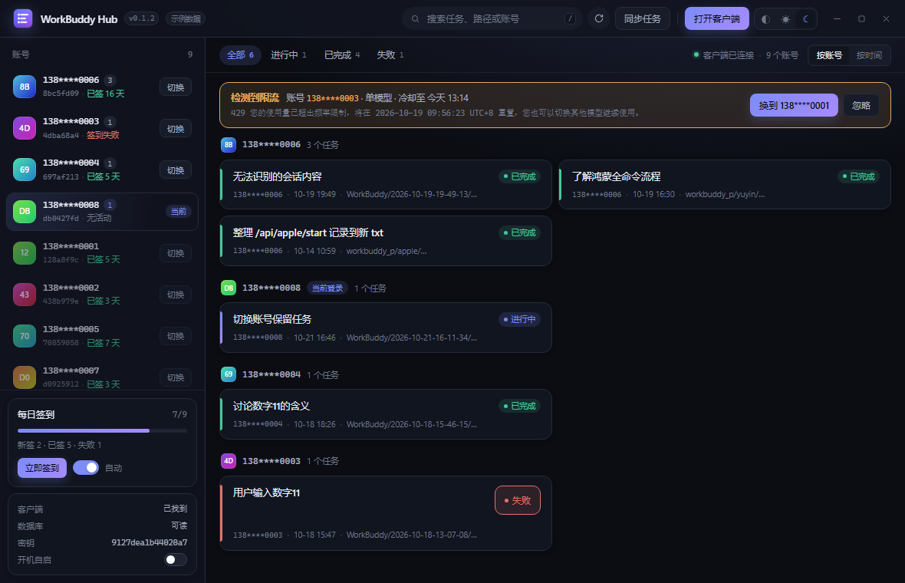
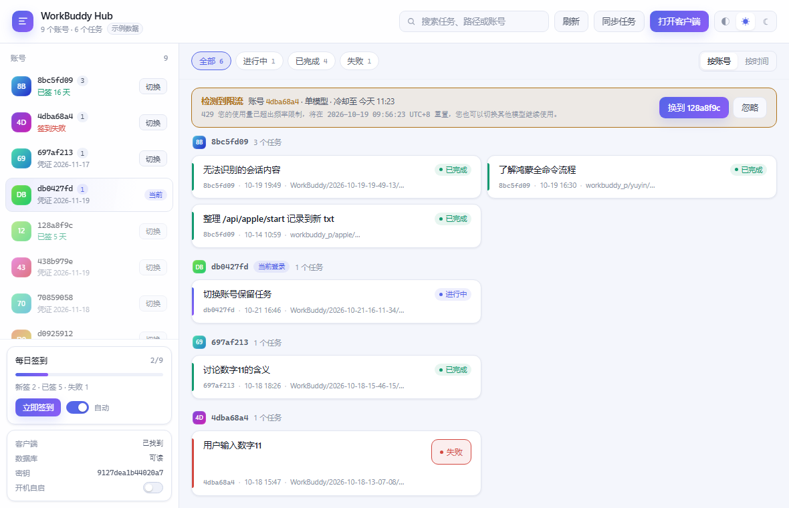
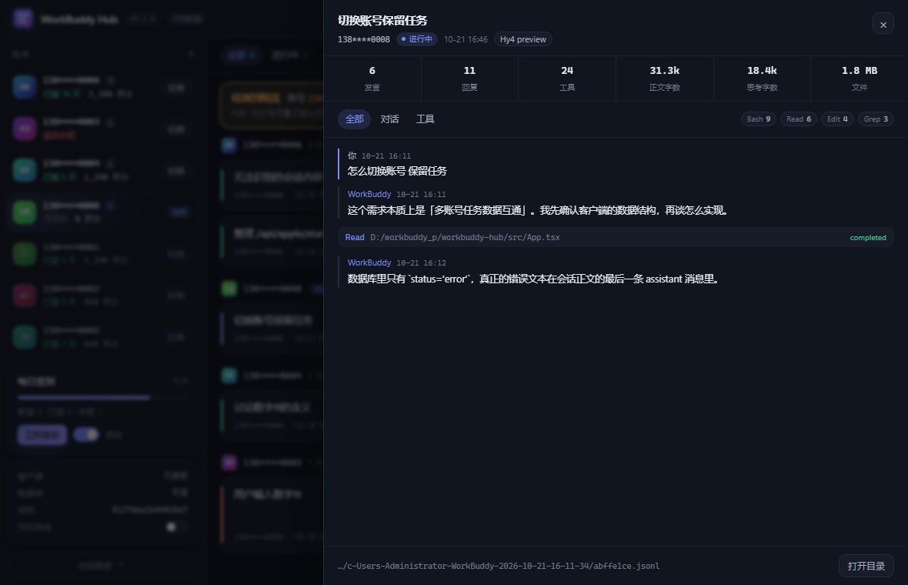

# workbuddy-hub

[简体中文](README.md) | **English**

**[Download the installer](https://github.com/ddGuo/workbuddy-hub/releases/latest)** (Windows 10 1803+)

Gathers the tasks scattered across multiple WorkBuddy accounts into one list, and switches the
account the official client is signed into with a single click. It also takes over the daily
check-in you would otherwise click through account by account.



## What problem it solves

| Pain | What hub does |
|---|---|
| Tasks are spread over 9 accounts; the client shows one at a time | Read-only aggregation of every account's sessions, grouped by account or time |
| Switching means signing out, signing in, then losing track of the old tasks | Quit → write credentials → unify → restart, in one click; ownership is reversible |
| **After switching, tasks and conversations are gone** | **Every task is still in the list, and opening one shows the full conversation** |
| You only notice a 429 by hitting it yourself | Scans failed sessions for 429, offers a one-click switch in the UI |
| You have to check in on every account every day | Automatic check-in on startup, with streak and failure reasons |
| To see what a task talked about, you dig through jsonl | Click a card and read the conversation; tool calls expand in place |

### Zero-gap account switching (the headline feature)

Switching accounts is usually about "keep working, just on another account's quota", not
"start over on a fresh account". hub makes that literal:

- The client's **native task list** shows every task — you don't live inside a separate tool
- Open any of them and it is the same conversation: messages, tool calls, file snapshots, all there
- The conversation body (jsonl) is **never touched**; only `sessions.user_id` in the database changes
- The original ownership is archived, so `hub unify --rollback` restores it at any time

Verified against 9 accounts: after unifying, the task list is complete and the context is continuous.

## Features

- **Zero-gap switching** — tasks survive the switch, conversations pick up where they left off
- **Task overview** — cross-account list, status filters, search by title / path / account (`/` to focus), grouped by account or time
- **Automatic account archive** — sign a new account into the client and hub saves it, no external tool needed
- **Account identity** — masked phone numbers (`199****9283`), check-in streak and **remaining credits**
- **Collapsible sidebar** — hide the check-in / unify / client cards to make room for accounts
- **One-click switch** — backup credentials and database → atomic write → unify → restart, automatic rollback on failure
- **Task unification** — rewrites `sessions.user_id` so the native list shows everything; original ownership archived
- **Rate-limit detection** — reads the raw 429 text, determines scope (single model vs. account quota) and reset time
- **Task detail** — full conversation in a drawer; tool calls collapse to one line
- **Daily check-in** — automatic across accounts, with streak days and failure reasons
- **Tray resident** — closing hides to tray, optional autostart, single instance
- **Two themes** — follow system / light / dark

## Ground rules and boundaries

**Model requests always come from the official client.** hub only touches the client's own
credential file and database: it puts an account's credentials back and points task ownership at
the current account. Headers, UA, device fingerprint and signatures are the client's native ones —
the server sees a normal account login.

**Only two features call APIs directly: daily check-in and account profile.** Both use the
account's own token against the official endpoints (check-in status + one claim per day; profile
for nickname and phone number). Neither involves model requests, goes through a third party, or
forges the client's anti-bot header. Beyond these two, hub sends nothing to the server.

**Read-only aggregation; writes are reversible.** The task list is filtered by `sessions.user_id`,
so unification rewrites that field. Original ownership is stored in
`~/.workbuddy-hub/ownership.json` and can be restored with `hub unify --rollback`.

> Design notes, risk boundaries and measurement results: [technical notes](docs/workbuddy-hub-技术说明.md) (in Chinese).

---

## Quick start

### Install

Download `WorkBuddy.Hub_<版本>_x64-setup.exe` from
[Releases](https://github.com/ddGuo/workbuddy-hub/releases/latest) and run it. There is also a
portable `workbuddy-hub.exe` (frontend embedded in the binary).

To share it with someone, use this stable link (always points at the latest release):

```
https://github.com/ddGuo/workbuddy-hub/releases/latest
```

> The installer is not code-signed, so SmartScreen may warn you: "More info → Run anyway".
> If you prefer, build it yourself — see below.

Launch it from the **Start menu or a desktop shortcut** the first time. It then lives in the tray;
clicking the icon again only brings the existing window to the front.

Pushing a `v*` tag builds and publishes a release automatically
(`.github/workflows/release.yml`) — no local packaging or manual upload.

### Requirements

| Dependency | Notes |
|---|---|
| Windows 10 1803+ | Needs the WebView2 runtime and the built-in `curl` (both ship with Windows 11) |
| Rust stable | Build only |
| Node 20+ | Frontend build (use npm, not pnpm) |
| WorkBuddy client | Any install path; hub discovers it |

### Build from source

```bash
npm install          # frontend deps (pnpm blocks esbuild's build script)
npm run dev          # UI only, in a browser, with mock data
npm run tauri:dev    # official dev mode
npx tauri build      # produce the installer (frontend embedded in the binary)
```

> **Build through the Tauri CLI.** A plain `cargo build` produces a binary that does not load
> frontend assets — you get a black window. Tauri expects you to run a dev server in that mode.

---

## How it works

### Switching accounts

Four steps, in this order:

1. **Quit the client** (`taskkill` without `/F`, so it goes through WM_CLOSE and exits cleanly)
2. **Write credentials** — re-wrap the target account's token with the client's own at-rest key
   (AES-256-GCM) and write atomically
3. **Unify tasks** — point `sessions.user_id` at the target account
4. **Start the client** and wait until the process really exists

Both the credential file and the database are backed up first, and any failure rolls back. The
client holds a single-instance lock (`app/lockfile`), so a hot switch is not possible.

### Task unification

The client filters the task list purely by `sessions.user_id`. Point every account's sessions at
one uid and the native list shows them all. Measured preconditions:

- All 18 sessions are `transport='local'` — nothing is uploaded, so a rewrite is not overwritten
- No triggers, no views, no foreign keys reference `sessions`
- All four indexes involving `user_id` are partial: `WHERE transport='cloud'`

```bash
hub unify                 # dry run (default, no writes)
hub unify --force         # actually rewrite, with an online snapshot first
hub unify --status        # show current unification state
hub unify --rollback      # restore from the ownership table
```

Unification is idempotent: original uids are recorded only for sessions not yet in the ownership
table, so repeated runs do not pollute it. Soft-deleted sessions are included — otherwise a
deleted task pops back after switching.

Only `sessions.user_id` changes; **the conversation body is untouched**, which is why context and
tool-call history survive the switch.

### Rate-limit detection

The client does not store errors in the database; it only flips a task's `status` to `error`. The
real message lives in the last assistant message of the session:

```
429 您的使用量已超出频率限制，将在 2026-10-19 09:56:23 UTC+8 重置，
    您也可以切换其他模型继续使用。
```

That single sentence answers three questions:

| Read from the text | Used for |
|---|---|
| `429` / `频率限制` / `积分不足` | whether to switch |
| `您也可以切换其他模型` | scope: **single model** or **whole account** |
| `将在 … 重置` | exact cooldown; without it, back off 10 min / 30 min / 24 h |

```bash
hub watch --once          # one scan, report only
hub watch                 # keep monitoring, report only
hub watch --auto          # switch on limit (skipped while tasks are running)
```

The scan covers sessions updated in the last 24 hours, **not just `status='error'`**: after a
model-level limit the client often retries with another model and the task ends as completed,
with the error text buried mid-conversation. Matching only accepts upstream error wording
(`429 ...`, `rate limit`, `switch to another model`), so an assistant discussing rate limits
does not trigger a false alarm.

Detection runs in the background every 5 seconds (session files are cached by mtime), and a new
limit pops a **bottom-right notification** (plus a system notification when the window is not in
the foreground, naming the model): "switch to xxx" performs the switch right away
(falling back to the confirmation dialog when tasks are running), while "verify" sends a real
`max_tokens=1` request with that account's credentials to confirm with the server.
Hovering the "switch" button shows a popover listing the models currently limited for that account.

Manual probe: `hub probe-model --uid <prefix> --model <model id>`.

Two safety valves: **never switch while tasks are running** (a restart would interrupt all of
them), and the cooldown table is persisted (the same account is not switched away twice for the
same error).

The UI only reports: every minute it scans failed sessions and, on a 429, shows account, scope,
cooldown and the raw text above the list, with a "switch to xxxxxxxx" button that goes through the
normal confirmation flow.

### Task detail

Conversation bodies live in `projects/<encoded cwd>/<session-id>.jsonl`, with seven record types
mixed together. The preview keeps four (user, assistant, tool call, tool result); `reasoning` is
only counted, not displayed — it is usually more than half the file and would push the actual
conversation off screen.

| Rule | Why |
|---|---|
| Strip `<system-reminder>` | Every user turn is preceded by hundreds of lines of environment context |
| Return the last 400 entries | Multi-day sessions have tens of thousands |
| Truncate each body to 4000 chars | Avoid rendering megabytes of text into the WebView |
| Merge call and result into one line | Otherwise a single Bash call takes two rows |

Parsing is read-only and writes nothing. From the CLI:

```bash
hub transcript abffe1ce --tail 8
```

### Daily check-in

Two official endpoints, called with the account's own token:

```
POST {domain}/v2/billing/meter/checkin-activity-status   status
POST {domain}/v2/billing/meter/daily-checkin             claim today's credits
Authorization: Bearer <accessToken> · X-User-Id · X-Domain
```

| Design | Why |
|---|---|
| No HTTP crate — use the system `curl` | Dozens fewer dependencies; curl uses Schannel and the system trust store |
| Request config via `stdin` (`curl -K -`) | The token never appears in argv or a temp file |
| First run 20 s after start, then every 30 min | Checked in at boot, and it crosses midnight |
| Resolved accounts only re-check status, never claim twice | Keeps the credit number in the list fresh |
| No retry for 6 h after a failure | Expired credentials should not be hammered; manual runs are exempt |
| Do not forge `X-Device-Token` | That is the client's Turing SDK anti-bot header; it works without it |

State lives in `~/.workbuddy-hub/checkin.json` (date, result, check-in points, streak per account).

> The check-in API's `total_credits` is **cumulative check-in points**, not a balance. The
> remaining credits shown in the account list come from
> `POST {domain}/billing/meter/get-user-resource-summary` (`TotalCredits`), refreshed every 30 seconds for the
> current account (10 minutes for the rest) and cached in `~/.workbuddy-hub/credits.json`.
Enabled by default; turn it off or hit "Check in now" at any time.

One measured detail: the server reports "already claimed today" as **HTTP 400**
(`今天已签到，请明天再来`), not 200 with a business code. hub classifies it as `already`,
so a race with the official client never shows up as a failure.

```bash
hub checkin --status          # inspect only
hub checkin                   # claim for every account
hub checkin --uid 128a8f9c    # one account
```

### Tray, autostart, single instance

The window is **frameless**: the top row is the title bar. Drag empty space to move it,
double-click to maximize/restore; on the right sit the theme switch and
minimize / maximize / close.

Closing no longer exits — it hides to the tray, because switching and check-in scheduling need
the process alive. Left-click the tray to show the window; right-click for "show / quit".
Alt+F4 also hides to the tray.

Autostart is a plain registry value under
`HKCU\Software\Microsoft\Windows\CurrentVersion\Run` named `WorkBuddyHub`: current user only, no
admin rights, easy to delete on uninstall.

A second launch does not create a second instance: it notifies the running one over
`127.0.0.1:47821`, which brings its window forward. If the port belongs to something else, startup
proceeds without the mutex rather than refusing to start.

---

## UI and themes

Three options in the top-right: **follow system / light / dark**, persisted in `localStorage`.

| Dark | Light |
|---|---|
|  |  |

- "Follow system" does not pin a result — it listens to `prefers-color-scheme`, so the UI changes
  when the OS switches to night mode
- Light is not an inversion of dark: `#f4f6fc` background, pure white cards, softer shadows, and
  status colors darkened one step for contrast
- Account avatars are a gradient derived from the uid — the same account always gets the same color
- The theme is resolved by an inline script before the bundle loads, so light systems do not flash black

Task detail:



---

## CLI

`hub` lives at `target/debug/hub` after `cargo build`.

```bash
hub probe                 # detect client path, credential file, data dir
hub accounts              # account overview: task count, credential expiry, empty ones
hub tasks                 # tasks from all accounts (--uid <prefix> to filter)
hub verify                # decrypt every account's credentials
hub switch --to 697af213  # switch (dry run by default, --force to write)
hub unify [--force|--status|--rollback]
hub watch [--once|--auto]
hub transcript <id>       # preview a conversation (--tail N)
hub checkin [--status] [--force-claim]   # daily check-in (--force-claim hits the claim API for diagnosis)
hub profile               # masked phone numbers and nicknames
hub authhash              # credential hashes, for parity checks against the TS implementation
```

Tests:

```bash
cargo test     # 30 tests: AAD layout, encrypt/decrypt round-trip, atomic write, backup cleanup,
               #            transcript parsing, check-in state, phone masking
```

---

## Layout

```
workbuddy-hub/
├─ Cargo.toml            # workspace (core + cli)
├─ core/                 # pure logic, unit-testable, no Tauri
│  └─ src/
│     ├─ client_compat.rs   client discovery / at-rest key
│     ├─ client_control.rs  quit / wait / start the client
│     ├─ auth_crypto.rs     AES-256-GCM with a custom AAD
│     ├─ account_store.rs   account library reader (seconds/ms tolerant)
│     ├─ task_index.rs      read-only task aggregation
│     ├─ task_unify.rs      unification + ownership table + rollback
│     ├─ rate_limit.rs      429 parsing from jsonl
│     ├─ transcript.rs      conversation preview (messages / tools / stats)
│     ├─ checkin.rs         daily check-in (curl + local state)
│     ├─ profile.rs         nickname / masked phone via /console/accounts
│     ├─ http.rs            minimal curl-based GET/POST (config over stdin)
│     ├─ daemon.rs          cooldown table / account picking / switch orchestration
│     └─ switch_engine.rs   switch: backup / atomic write / rollback
├─ cli/                  # command-line verification tool
│  └─ src/main.rs
├─ src/                  # React frontend
│  ├─ App.tsx               task list + account rail + limit banner + check-in card
│  ├─ TaskDetail.tsx        conversation drawer
│  ├─ theme.ts              theme (system / light / dark)
│  ├─ api.ts                invoke wrapper (falls back to mock data in a browser)
│  └─ styles.css            two-theme design system
├─ src-tauri/            # Tauri 2 shell
│  ├─ src/lib.rs            21 IPC commands + tray + check-in scheduler
│  ├─ icons/tray.png        tray icon (32×32)
│  └─ tauri.conf.json
├─ docs/                 # design notes (Chinese)
└─ tools/                # parity scripts
```

## Runtime paths

| Purpose | Path |
|---|---|
| Session index | `~/.workbuddy/workbuddy.db` → `sessions` |
| Conversation body | `~/.workbuddy/projects/<encoded cwd>/<session-id>.jsonl` |
| Client credentials | `%LOCALAPPDATA%\CodeBuddyExtension\Data\Public\auth\workbuddy-desktop.info` |
| Account library (auto-saved) | `~/.workbuddy-hub/accounts/<uid>.json` |
| hub state | `~/.workbuddy-hub/`: `ownership.json`, `runtime.json`, `checkin.json`, `profiles.json`, `backups/` |

Credential format and crypto details: [technical notes, section 10](docs/workbuddy-hub-技术说明.md)
(in Chinese).

---

## FAQ

**The window is black with only a title bar.**
Check the launch environment first: when started from a terminal that injects sandbox components,
the WebView2 child gets a third-party DLL injected (on this machine `tsbx.dll`) and the renderer
crashes. To confirm:

```powershell
Get-ChildItem "$env:LOCALAPPDATA\cn.workbuddy.hub" -Recurse -Filter *.dmp |
  Sort-Object LastWriteTime -Descending | Select-Object -First 1
```

If every launch adds a `.dmp`, that is it. The injection follows the **process tree**, so clearing
environment variables does not help — start it from a clean parent (Explorer, Start menu).

**After closing and reopening, a black window appears.**
Two causes stack up: closing only hides to the tray, so clicking the shortcut starts a
**second process that creates its own window** before discovering the running instance — that
window is black. Meanwhile the restored window may draw a single black frame because WebView2
was suspended while hidden. Since 0.1.4 the single-instance check happens before any window is
created, and showing the window forces a repaint.

If it still happens: end `workbuddy-hub.exe` (and any leftover `msedgewebview2.exe`) in Task
Manager, then relaunch.

**The window stops responding while switching accounts.**
Fixed in 0.1.5: synchronous Tauri commands run inline on the main thread, and a switch waits for
the client to quit and restart — tens of seconds with no message pump. Those commands now run on
`spawn_blocking`, so the progress dialog updates step by step.

**After signing out, switching says "credential file not found".**
It now says "the client is not signed in — sign in to at least one account first", with a banner
and an "Open client" button in the account rail. Historical accounts stay visible, but the switch
button is disabled. The credentials are still valid: sign in to any account, come back, and it
recovers within 500 ms.

**`cargo build` fails with TLS / 502.**
A local proxy is rejecting crates.io; configure a mirror (`~/.cargo/config.toml` pointing at rsproxy).

**Linker complains about `link.exe` or bad arguments.**
Git ships `usr/bin/link.exe`, which shadows the MSVC linker; put the MSVC `bin/Hostx64/x64`
directory first on PATH.

**Black boxes flash when starting or switching.**
Fixed. Every external command (`tasklist`, `taskkill`, `powershell`, `curl`) is spawned through
`hub_core::proc::hidden()` with `CREATE_NO_WINDOW`. That includes the 9 profile and 9 check-in
requests issued on startup.

**All check-ins fail.**
Run `hub checkin --status` and read the server response. Common causes: expired account
credentials (sign in once in the client), or no `curl` on the system (before Windows 10 1803).

---

## Pitfalls (read before changing code)

1. **Timestamp units are inconsistent.** In the account library, 9 archives store `expiresAt` in
   milliseconds and 1 in seconds. Treating everything as seconds yields a 56,845-year validity,
   i.e. "never expires". Always run timestamps through `normalize_ts()` (values above `1e11` are ms).
2. **The client is not always in the default path.** Discovery covers `WORKBUDDY_ELECTRON_BIN`,
   running processes, Program Files, and common drive roots.
3. **`link.exe` conflict.** See above.
4. **The client holds a single-instance lock** (`app/lockfile`), so switching requires
   quit → write credentials → restart; no hot swap.
5. **Copy files in the account library.** `.bak`, `.imported-*` and `baseline-*` are not canonical;
   only `<uuid>.json` counts. When a uid appears twice, keep the canonical file.
6. **The credential file has no integrity check.** The neighbouring `observation.json` is only an
   active-session marker (`facts: []`), so rewriting auth does not trip a validation failure — but
   that also means a bad write is only discovered when the client fails to sign in. Hence backups
   and rollback are mandatory.
7. **`sessions.user_id` is not the truth of ownership.** Unification flattens that field; the UI
   reads real ownership from `ownership.json`, and rollback follows it.

## Security boundaries

- The account library is **plaintext** (a deliberate decision, no encryption). It is equivalent to
  login credentials: never commit it, never put it on a share.
- Only manages accounts **you have already signed into yourself**; no account distribution, no
  proxy login.
- All account operations stay on this machine; no credentials are uploaded.
- Exactly two outbound features — check-in and profile. Tokens are sent only to
  `https://<the account's own domain>`, never to a third party, and are not written to logs or
  temp files.

## Status

| Stage | Scope | State |
|---|---|---|
| M0 | Read-only task aggregation | **Verified**: tasks from 9 accounts listed |
| M1 | Decrypt client credentials with the at-rest key | **Verified**: parity match, 9/9 decrypted |
| M2 | Account switch (backup → write → rollback) | **Tested**: client works after a switch |
| M3 | Desktop shell + task overview | **Running**: Tauri 2 window, ~40 MB resident |
| M3.5 | Task unification | **Tested**: 13 tasks merged, ownership table has 19 rows; list and context complete after switching |
| M4 | Rate-limit detection (L1, semi-auto) | Detection verified; `--auto` switching not yet triggered for real |
| M5 | Task detail | **Done**: drawer preview, expandable tool calls |
| M6 | Tray + autostart + single instance | **Done** |
| M7 | UI redesign + two themes | **Done**: three modes, follows system |
| M8 | Daily automatic check-in | Status read for 9 accounts; claim path awaits the next day |

Not done yet:

- Real `watch --auto` switching (logic ready; waiting for a moment with no running tasks)
- Whether the client refreshes its list without a restart after `user_id` changes
- L2 MITM proxy (truly seamless switching): requires installing a root certificate, not adopted

## License

MIT, see [LICENSE](LICENSE).
