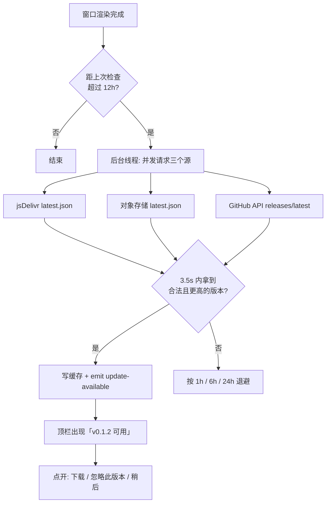

# 更新检测方案

> 目标：普通用户装完就能知道有没有新版；GitHub 打不开的也能知道；
> 任何网络状况都不能拖住界面。

## 一、现状与结论

现在项目里**没有任何更新检测**（`tauri-plugin-updater` 没装，代码里也没有版本查询）。
用户唯一知道新版的途径是自己去 Releases 页面看。

所以回答第一个问题：**只靠 GitHub 不行**。

- `api.github.com` 在国内多数网络需要代理；未认证调用还有 60 次/小时/IP 的限制
- Release 附件实际落在 `objects.githubusercontent.com`，国内经常连不上或几十 KB/s
- `github.com` 页面本身能开，但让人定期手动去看，等于没有更新机制

结论：要做「检测」，必须假设 GitHub 可能不可达，准备一条国内能走通的备用通道；
同时检测动作必须在后台、带超时，失败就静默，不能影响启动和使用。

## 二、通道能力对比

| 通道 | 国内可达性 | 能放什么 | 限制 |
|---|---|---|---|
| `api.github.com` | 差，常需代理 | 版本号、下载地址 | 60 次/小时/IP |
| `github.com` 页面 | 一般 | 发布页 | 需人工点开 |
| `objects.githubusercontent.com` | 差 | 安装包 | 大文件经常超时 |
| `raw.githubusercontent.com` | 差，常被污染 | 文本文件 | 不可靠 |
| `cdn.jsdelivr.net` | 较好 | **仓库里的文件** | 不代理 Release 附件；`@main` 有约 12h 缓存 |
| 对象存储（COS/OSS/R2） | 好 | 清单 + 安装包 | 流量费；绑定 CDN 需备案域名 |

由此得出两条通道：

- **清单（几 KB 的 JSON）**：放仓库里，用 jsDelivr 拉；GitHub API 作为海外主源
- **安装包（3 MB）**：GitHub 给海外用户，对象存储给国内用户

## 三、目标与非目标

**目标**

1. 启动后能自动发现新版本，提示一次，不打扰
2. 支持「忽略此版本」，同一版本不再提示
3. GitHub 不可达时仍能检测（走 jsDelivr）
4. 检测过程不阻塞 UI、不阻塞退出；断网、DNS 污染、超时都静默失败
5. 下载地址可切换：优先国内镜像，其次 GitHub

**非目标**

1. 不做静默自动安装。安装包没有代码签名，静默执行会直接撞 SmartScreen，体验更差
2. 不做强制升级、不做使用数据上报
3. 不引入第三方加速站（ghproxy 之类），可用性和信任都不可控

## 四、总体流程



关键点：三个源**并发**发起，谁先返回合法结果用谁，不是串行等待 —— 串行最坏要 10 秒。

## 五、清单格式

文件名 `latest.json`，放在仓库根目录；CI 在打 tag 时生成并提交回 `main`。
结构刻意对齐 `tauri-plugin-updater` 的 schema，以后接入插件只换 endpoint。

```json
{
  "version": "0.1.2",
  "notes": "修复 xxx；新增 yyy",
  "pub_date": "2026-10-23T10:00:00Z",
  "platforms": {
    "windows-x86_64": {
      "url": "https://github.com/ddGuo/workbuddy-hub/releases/download/v0.1.2/WorkBuddy.Hub_0.1.2_x64-setup.exe",
      "mirror": "https://<bucket>.cos.ap-guangzhou.myqcloud.com/WorkBuddy.Hub_0.1.2_x64-setup.exe",
      "sha256": "…",
      "size": 3056062
    }
  }
}
```

- `mirror` 为空时只用 `url`
- `sha256` 用于下载后核对（P0 只展示，P2 自动校验）
- 清单本身走 HTTPS，内容不含任何用户信息

## 六、判定规则

| 情况 | 行为 |
|---|---|
| `remote > local` 且不等于被忽略的版本 | 提示 |
| `remote == local` | 不提示 |
| `remote < local`（回退） | 不提示，记日志 |
| 版本号不是 `x.y.z` | 丢弃该响应，继续等其他源 |
| 三个源都失败 / 超过 3.5s | 静默失败，按退避重试 |
| 清单 404 / JSON 非法 / URL 非 https | 丢弃，不影响其他源 |

「忽略此版本」写入 `~/.workbuddy-hub/update.json`，换新版本后会重新提示。

## 七、不卡死进程的具体做法

| 措施 | 说明 |
|---|---|
| 独立线程 + detach | `std::thread::spawn`，不 `join`；窗口关掉/退出时线程随进程结束 |
| 延迟启动 | 窗口渲染完成 3 秒后再检查，不和首屏抢资源 |
| 硬超时 | `curl --connect-timeout 2 --max-time 3.5`，DNS 卡住也会被 `--max-time` 掐断 |
| 单飞 | `AtomicBool` 防重入，避免用户狂点刷新时叠加请求 |
| 异步返回 | 结果通过事件 `update-available` 推给前端；命令本身不 `await` 网络 |
| 失败退避 | 1h → 6h → 24h，避免离线用户反复打无用的请求 |
| 不阻塞退出 | 退出逻辑不等待检测线程；curl 子进程随父进程结束 |
| 复用 hidden | `curl` 走 `proc::hidden`，不闪黑框 |

频率：启动一次 + 每 12 小时一次。GitHub 未认证 60 次/小时，这个量级完全够。

## 八、界面

不做弹窗，避免打断。位置在顶栏品牌名右侧：

```
[icon] WorkBuddy Hub  v0.1.1  ● 有新版
```

点开是 popover：

```
v0.1.2 可用
· 修复切换账号后任务列表偶发不刷新
· 新增更新检测

[下载]  [忽略此版本]  [稍后]
```

- 「下载」调用系统浏览器打开地址（优先 `mirror`），不内嵌下载器 —— 避免在应用里处理代理、证书、断点续传
- 「忽略此版本」写缓存；「稍后」关闭 popover，下次启动再提示

## 九、为什么先不做应用内自动更新

`tauri-plugin-updater` 能做下载、校验、静默安装，但现在有三个现实问题：

1. 安装包未签名，静默安装会被 SmartScreen 直接拦下，用户更懵
2. 更新端点若还是 GitHub，墙内照样下载失败
3. 需要额外管理 minisign 密钥，密钥丢了就无法推送更新

所以分阶段：先解决「知道有新版」，再解决「下得动」，最后才考虑「应用内装」。

## 十、分阶段实施

### P0 — 检测与提示（建议版本 0.2.0）

- `core/update.rs`：版本比较、清单解析、三源并发探测
- `latest.json`：CI 打 tag 时生成并提交回 main（jsDelivr 读它）
- IPC：`update_check` / `update_ignore` / `update_state`
- UI：顶栏提示 + popover
- 预计改动：Rust ~180 行，前端 ~80 行，CI ~30 行

### P1 — 国内下载通道

- 对象存储（腾讯云 COS / 阿里云 OSS）公开读，CI 上传安装包并写入 `mirror`
- 可选：Gitee Release 作为第二镜像
- 成本：每月几毛到几块，取决于下载量

### P2 — 应用内更新（可选）

- 接入 `tauri-plugin-updater`，沿用现有清单
- 加 minisign 签名；下载后校验 sha256 再启动安装器
- 需要给安装包做代码签名，否则静默安装仍会被拦

## 十一、验收用例

| 场景 | 预期 |
|---|---|
| 正常联网 | 启动 3s 后出现新版本提示 |
| 断网 | 无任何提示，界面正常，1h 后重试 |
| hosts 屏蔽 `api.github.com` | 仍能从 jsDelivr 拿到版本 |
| jsDelivr 超时 | 3.5s 内放弃，不影响使用 |
| 返回非法 JSON | 丢弃，回退到其他源 |
| 版本相同 / 更低 | 不提示 |
| 点「忽略此版本」 | 重启后仍不提示；发新版后重新提示 |
| 检查途中退出程序 | 进程立即结束，无残留 curl |

## 十二、风险与说明

- **jsDelivr 缓存**：`@main` 分支文件最多缓存 12 小时，刚发版可能延迟感知。对「提示更新」可接受；
  要立刻生效可用 `@<tag>` 路径，但探测时不知道最新 tag，所以仍以 `@main` 为主。
- **对象存储费用**：按量计费，安装包 3 MB，千次下载约几元。可在 P1 再决定是否长期保留。
- **降级攻击**：所有源都是 HTTPS；清单里的 `sha256` 会在下载后核对。若以后做应用内更新，再加 minisign 签名。
- **隐私**：请求只带 UA（`WorkBuddyHub/0.1.1`），不带账号、不带设备信息、不上报检查结果。
